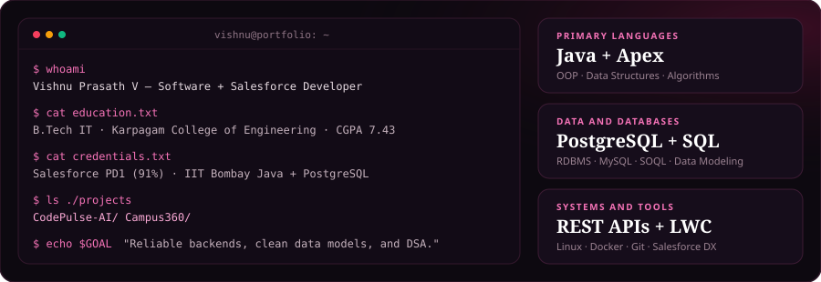

<!-- HERO BANNER -->

  

<!-- SOCIAL BADGES -->

  
  
  
  

 

<!-- ABOUT & TERMINAL SECTION -->
<h3>Hello, I'm <i>Vishnu.</i></h3>

  

 

<!-- PROOF / CREDENTIALS SECTION -->
<h3>Proof, <i>on the record.</i></h3>

  

 

<!-- PROJECTS SECTION -->
<h3>Products, not <i>assignments.</i></h3>

  

  

 

  

  

